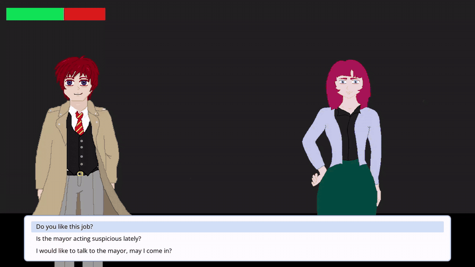

[Español](README.md)

# Where the Cheesecakes Go

A detective visual novel. You play Nikola, the only person in the city who remembers that cheesecakes ever existed, and you have to find out why they vanished from everyone else's memory.



> **Released** · v1.0.0 · Windows and Linux · English only · itch page: coming soon

## How to play

- To be allowed to investigate, Nikola lies to his boss. The lie you pick decides the case: the mayor, the restaurant chains or the aliens. Each one is a separate path, with its own places and characters.
- In each place you choose who to talk to and what to ask. Questions that give you a clue raise Nikola's soul bar; questions that lead nowhere, or that you repeat, lower it. If the soul reaches zero, you lose.
- You need a clue to move on to the next place. Without one, Nikola doesn't know where to go.
- Each path ends in a decision with different endings.

| Action | Mouse | Keyboard |
|---|---|---|
| Advance dialogue | Click | Enter or Space |
| Pick an answer | Click | Arrow keys and Enter |
| Menu buttons | Click | — |
| Pause | — | Esc or P |

## Context

*Where the Cheesecakes Go* is the project for the Video Game Design and Development Workshop (Taller de Diseño y Desarrollo de Videojuegos) at the University of Chile, second semester of 2022. It was a team project with Evelyn Avila (Evi). I wrote most of the story and dialogue; Evi made the art: the characters, the intro panels and the menu. We wrote the logic and code together.

All 2022 commits are under Evi's account (EliKasher). The split of the work is the one described here. In 2022 I went by **past00**, my former account; today it's [clemgrass](https://github.com/clemgrass).

## How it's made

| | |
|---|---|
| Engine | Godot 3.5.1 |
| Language | GDScript |
| Dialogue | [Dialogue Manager](https://github.com/nathanhoad/godot_dialogue_manager) 1.17.4 |
| Platforms | Windows and Linux |

- **The script is a single file.** The whole story, about 1,900 lines, lives in `intro.tres`, a Dialogue Manager resource. It uses one title per place (`~ FoodDistrict1`), answers that jump to another title (`=> Park2`), conditions (`if clue == false`) and mutations (`do _soul_down()`) that call functions on the scene (`introduction.gd`).
- **Global state through signals.** The `Game` autoload (`game.gd`) holds the soul, Nikola's expression, the background and what has already been asked in each place. Its setters emit signals, and the soul bar (`soul.gd`), Nikola's portrait (`detective.gd`) and the background (`background.gd`) update themselves by listening to them.
- **Each place works as a hub.** Questions are marked as asked (`Q1`–`Q3`) so that repeating them costs soul, and the clue flag (`clue`) unlocks the next place. The marks reset when you leave.

### 2026 changes

While preparing the repo for publication:

- `addons/dialogue_manager/` was restored. It was missing from the repo, and the project doesn't open properly without it. It's v1.17.4: its compiled scripts are identical to the ones in the 2022 build.
- Export presets for Windows and Linux were added (`export_presets.cfg` was in `.gitignore`).
- Four misspelled image paths in the script were fixed. They made Nikola disappear on some lines.
- The soul goes back to 100 when a new run starts. Before, it carried over the value from the previous run.
- The 2022 executable was removed from `builds/`, since it predated the latest version of the script. Current builds are in [Releases](https://github.com/clemgrass/WhereTheCheesecakeGo/releases).

## Open and export

You need [Godot 3.5.1](https://github.com/godotengine/godot/releases/tag/3.5.1-stable), the standard version (not Mono), with its export templates. Godot 4 can't open the project without converting it.

1. Open `project.godot` in Godot 3.5.1. The first time, it imports the resources.
2. Run the game with F5. It starts at the menu (`scenes/main_menu.tscn`).

To export without opening the editor (the *Windows Desktop* and *Linux/X11* presets are already in `export_presets.cfg`, with the `.pck` embedded in the executable), where `godot` is the Godot 3.5.1 executable:

```
mkdir -p builds/windows builds/linux
godot --no-window --path . --export "Windows Desktop" builds/windows/WhereTheCheesecakesGo.exe
godot --no-window --path . --export "Linux/X11" builds/linux/WhereTheCheesecakesGo.x86_64
```

If the project has never been opened in the editor, open it once before exporting so it imports the resources.

## Credits and license

Team:

- **Evelyn Avila** (Evi, [EliKasher](https://github.com/EliKasher)): art (characters, intro panels and menu) and programming.
- **Clemente Grass Briones** ([clemgrass](https://github.com/clemgrass), formerly **past00**): story and dialogue (most of it), and programming.

Course: Video Game Design and Development Workshop, University of Chile, second semester of 2022. Instructor: **Elías Zelada**.

Third-party assets used by the game:

- [Dialogue Manager](https://github.com/nathanhoad/godot_dialogue_manager) 1.17.4 by Nathan Hoad (MIT). Its license is in `addons/dialogue_manager/LICENSE`.
- [monogram](https://datagoblin.itch.io/monogram) font by Vinícius Menézio (CC0).
- *UI Pack: Japanese Wave Pattern* by puppetbomb (CC BY-NC 3.0, non-commercial use), on the menu buttons and panels.

In the repo but not used by the game (they only appear in test scenes): the *Cyberpunk Street* background and its music by Luis Zuno ([ansimuz](https://ansimuz.itch.io)), and portraits by J. Claudee ([Sraye](https://sraye.itch.io)) and [Sutemo](https://sutemo.itch.io) (CC BY 4.0).

**License:** the code and the original art belong to their authors and are not licensed for reuse. Third-party assets remain under their own licenses.
