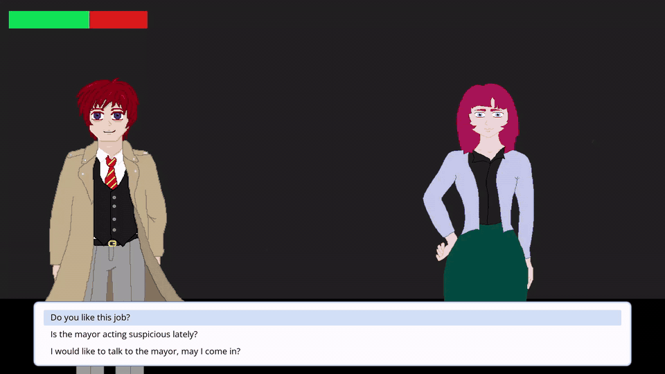

[English](README.en.md)

# Where the Cheesecakes Go

Novela visual de detectives. Eres Nikola, la única persona de la ciudad que recuerda que los cheesecakes existieron, y tienes que descubrir por qué desaparecieron de la memoria de todos los demás.



> **Terminado** · v1.0.0 · Windows y Linux · Solo en inglés · Página en itch: próximamente

## Cómo se juega

- Para poder investigar, Nikola le miente a su jefe. La mentira que eliges decide el caso: el alcalde, las cadenas de comida o los aliens. Cada uno es un camino distinto, con sus propios lugares y personajes.
- En cada lugar eliges con quién hablar y qué preguntar. Las preguntas que dan una pista suben la barra de alma de Nikola; las que no llevan a nada, o las que repites, la bajan. Si el alma llega a cero, pierdes.
- Para ir al siguiente lugar necesitas una pista. Sin ella, Nikola no sabe adónde ir.
- Cada camino termina en una decisión con finales distintos.

| Acción | Mouse | Teclado |
|---|---|---|
| Avanzar el diálogo | Clic | Enter o Espacio |
| Elegir una respuesta | Clic | Flechas y Enter |
| Botones de los menús | Clic | — |
| Pausa | — | Esc o P |

## Contexto

*Where the Cheesecakes Go* es el proyecto del ramo Taller de Diseño y Desarrollo de Videojuegos de la Universidad de Chile (segundo semestre de 2022). Lo hicimos en equipo con Evelyn Avila (Evi). Yo escribí la mayor parte de la historia y de los diálogos; Evi hizo el arte: los personajes, las viñetas de la intro y el menú. La lógica y el código los hicimos entre los dos.

Todos los commits de 2022 están a nombre de Evi (EliKasher). El reparto del trabajo es el que se describe aquí. En 2022 yo firmaba como **past00**, mi cuenta anterior; hoy es [clemgrass](https://github.com/clemgrass).

## Cómo está hecho

| | |
|---|---|
| Motor | Godot 3.5.1 |
| Lenguaje | GDScript |
| Diálogos | [Dialogue Manager](https://github.com/nathanhoad/godot_dialogue_manager) 1.17.4 |
| Plataformas | Windows y Linux |

- **El guion es un solo archivo.** Toda la historia, unas 1.900 líneas, vive en `intro.tres`, un recurso de Dialogue Manager. Usa un título por lugar (`~ FoodDistrict1`), respuestas que saltan a otro título (`=> Park2`), condiciones (`if clue == false`) y mutaciones (`do _soul_down()`) que llaman funciones de la escena (`introduction.gd`).
- **Estado global con señales.** El autoload `Game` (`game.gd`) guarda el alma, la expresión de Nikola, el fondo y lo que ya se preguntó en cada lugar. Sus setters emiten señales, y la barra de alma (`soul.gd`), el retrato de Nikola (`detective.gd`) y el fondo (`background.gd`) se actualizan solos al escucharlas.
- **Cada lugar funciona como un centro.** Las preguntas quedan marcadas como hechas (`Q1`–`Q3`) para que repetirlas cueste alma, y la pista (`clue`) desbloquea el paso al siguiente lugar. Las marcas se reinician al salir.

### Cambios de 2026

Al preparar el repo para publicarlo:

- Se restauró `addons/dialogue_manager/`, que no estaba en el repo y sin el cual el proyecto no abre bien. Es la v1.17.4: sus scripts compilados son idénticos a los del build de 2022.
- Se agregaron los presets de exportación para Windows y Linux (`export_presets.cfg` estaba en `.gitignore`).
- Se corrigieron cuatro rutas de imagen mal escritas en el guion, que hacían desaparecer a Nikola en algunas líneas.
- El alma vuelve a 100 al empezar una partida nueva. Antes arrastraba el valor de la partida anterior.
- Se quitó de `builds/` el ejecutable de 2022, que era anterior a la última versión del guion. Los builds actuales están en [Releases](https://github.com/clemgrass/WhereTheCheesecakeGo/releases).

## Abrirlo y exportarlo

Necesitas [Godot 3.5.1](https://github.com/godotengine/godot/releases/tag/3.5.1-stable), la versión estándar (no la Mono), con sus plantillas de exportación. Godot 4 no abre el proyecto sin convertirlo.

1. Abre `project.godot` en Godot 3.5.1. La primera vez importa los recursos.
2. Corre el juego con F5. Parte en el menú (`scenes/main_menu.tscn`).

Para exportar sin abrir el editor (los presets *Windows Desktop* y *Linux/X11* ya están en `export_presets.cfg`, con el `.pck` dentro del ejecutable), donde `godot` es el ejecutable de Godot 3.5.1:

```
mkdir -p builds/windows builds/linux
godot --no-window --path . --export "Windows Desktop" builds/windows/WhereTheCheesecakesGo.exe
godot --no-window --path . --export "Linux/X11" builds/linux/WhereTheCheesecakesGo.x86_64
```

Si el proyecto nunca se abrió en el editor, conviene abrirlo una vez antes de exportar, para que importe los recursos.

## Créditos y licencia

Equipo:

- **Evelyn Avila** (Evi, [EliKasher](https://github.com/EliKasher)): arte (personajes, viñetas de la intro y menú) y programación.
- **Clemente Grass Briones** ([clemgrass](https://github.com/clemgrass), antes **past00**): historia y diálogos (la mayor parte), y programación.

Ramo: Taller de Diseño y Desarrollo de Videojuegos, Universidad de Chile, segundo semestre de 2022. Profesor: **Elías Zelada**.

Assets de terceros que usa el juego:

- [Dialogue Manager](https://github.com/nathanhoad/godot_dialogue_manager) 1.17.4, de Nathan Hoad (MIT). Su licencia está en `addons/dialogue_manager/LICENSE`.
- Fuente [monogram](https://datagoblin.itch.io/monogram), de Vinícius Menézio (CC0).
- *UI Pack: Japanese Wave Pattern*, de puppetbomb (CC BY-NC 3.0, uso no comercial), en los botones y paneles de los menús.

En el repo, pero sin usar en el juego (solo aparecen en escenas de prueba): el fondo *Cyberpunk Street* y su música, de Luis Zuno ([ansimuz](https://ansimuz.itch.io)), y retratos de J. Claudee ([Sraye](https://sraye.itch.io)) y [Sutemo](https://sutemo.itch.io) (CC BY 4.0).

**Licencia:** el código y el arte original son de sus autores y no se licencian para reutilizarlos. Los assets de terceros siguen bajo sus propias licencias.
